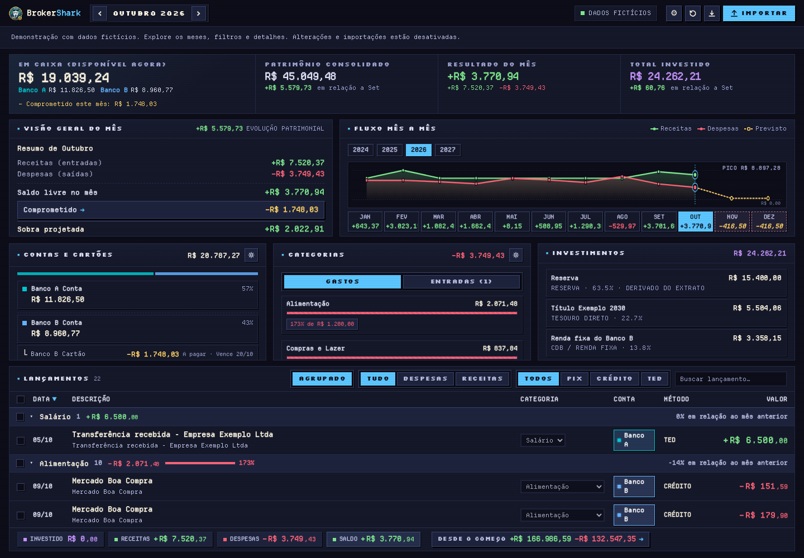

# BrokerShark

A local finance dashboard demonstration with entirely fictional data.

[Leia em português](README.pt-BR.md).

## Run the showcase

Requires Node 26 or newer.

```bash
cd backend
npm ci
npm start
```

Open `http://127.0.0.1:8000`. Use `npm start -- --port 8080` for another port.

Each launch creates a new synthetic ledger in a temporary directory. The server
never opens an external ledger, reads personal configuration, or checks personal
backup directories. Its database is read-only; imports and mutations are blocked.
The interface labels the data as fictional.

Accounts, merchants, transactions, invoices and investment positions are invented.
The generator uses a fixed random seed and covers the 24 months ending today.
No anonymized copy of an actual ledger is used. Old screenshots are not included.

## Interface

The dashboard brings together available cash, net worth, monthly results and
investments. The chart separates measured months from future commitments.
Browse months, filter transactions and open account, category and investment
details. Settings and import panels explain the app without accepting files or
changing data. Local fonts, keyboard focus and reduced motion support the layout
on desktop, tablet and mobile.



The images in `docs/demo` were captured from the showcase and its fictional ledger.

## Verify

```bash
cd backend
npm test
npm run privacy
npm run demo -- /tmp/new-fictional-ledger.db
npm run audit -- /tmp/new-fictional-ledger.db
```

Choose a new destination for the generator: it refuses to overwrite existing
files. The privacy check examines all reachable history, including commit metadata,
and rejects personal profile descriptions, private email addresses, home paths
and data files. It does not certify copies outside this repository.

## Source

React and fonts are bundled locally. Node serves the interface and a synthetic
SQLite ledger. Money is represented as integer cents; financial rules have unit
tests and the generated ledger is checked against invariant queries.

The source includes format readers and domain logic for study. The showcase server
does not register import routes or allow writes. Financial institution names in
format adapters describe public formats, not anyone's accounts.

See [LICENSE](LICENSE) for permitted use and attribution.
